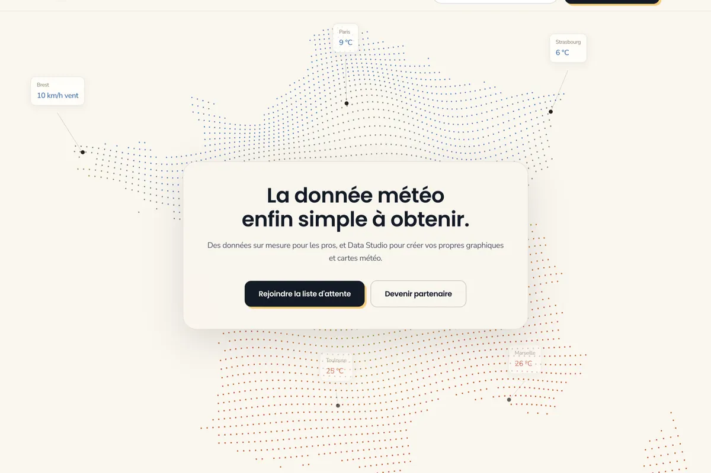
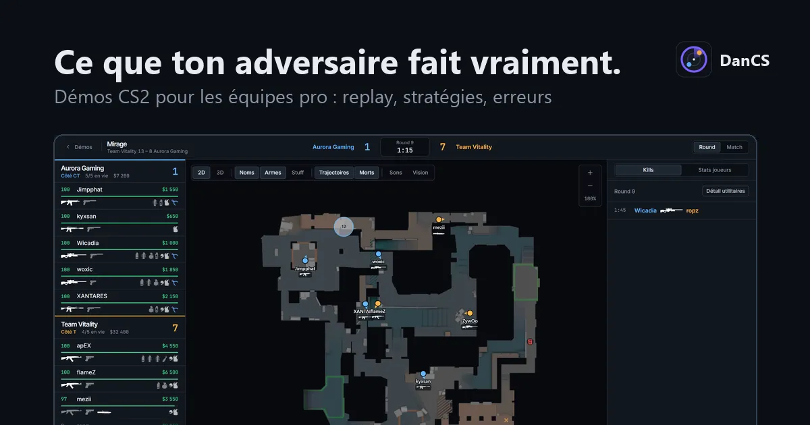
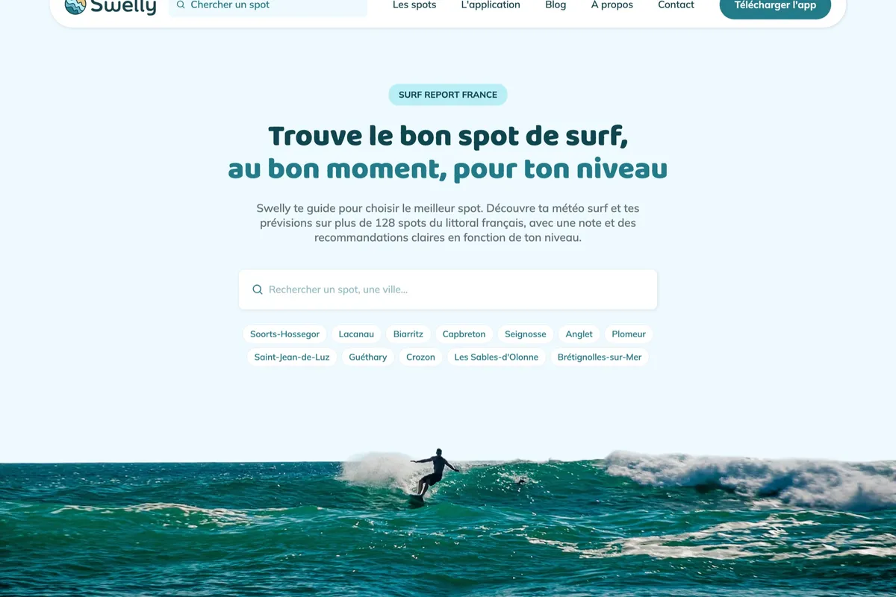

  

  
  
  

## 🚀 What I'm building

<table>
  <tr>
    <td width="33%" valign="top">
      
      <h3>Lyn Météo</h3>
      
Free-for-life weather app. Hourly forecasts for every commune in France, interactive graphs, no ads.

      <a href="https://www.lyn-meteo.fr">lyn-meteo.fr →</a>
    </td>
    <td width="33%" valign="top">
      
      <h3>DanCS</h3>
      
Counter-Strike 2 demo replay in 2D and 3D, with what every player saw and heard. Built for teams and analysts.

      <a href="https://www.dancs.app">dancs.app →</a>
    </td>
    <td width="33%" valign="top">
      
      <h3>Swelly</h3>
      
Surf forecasts made readable for beginners, with advice for every spot.

      <a href="https://swelly-surf.com">swelly-surf.com →</a>
    </td>
  </tr>
</table>

## 🧩 Open source

<table>
  <tr>
    <td width="50%" valign="top">
      <h3>Elysia</h3>
      
Contributor to the type-safe TypeScript framework for Bun. Bug fixes merged into the core, like cookies missing from SSE streams.

      <a href="https://github.com/elysiajs/elysia/pulls?q=is%3Apr+author%3ARouret">See my pull requests →</a>
    </td>
    <td width="50%" valign="top">
      <h3>Maestro tooling</h3>
      
<a href="https://github.com/Rouret/vscode-maestro-extension">vscode-maestro-extension</a> and <a href="https://github.com/Rouret/maestro-fsh-cli">maestro-fsh-cli</a>: write and structure Maestro mobile tests faster, with fewer mistakes.

    </td>
  </tr>
</table>

## ✍️ Latest writing

<!-- BLOG-POST-LIST:START -->
- [Why Every Idea Needs Time to Take Shape Before You Build](https://www.lucas-rouret.fr/articles/why-ideas-need-time-before-you-build)
- [Why I Almost Gave Up, And What Kept Me Going](https://www.lucas-rouret.fr/articles/why-i-almost-gave-up)
- [Stop Using useQuery From React Query](https://www.lucas-rouret.fr/articles/stop-using-usequery-from-react-query)
<!-- BLOG-POST-LIST:END -->

  Got a project, a hard problem or a side idea worth building? <a href="https://www.linkedin.com/in/rouret-lucas/">Let's talk.</a>

